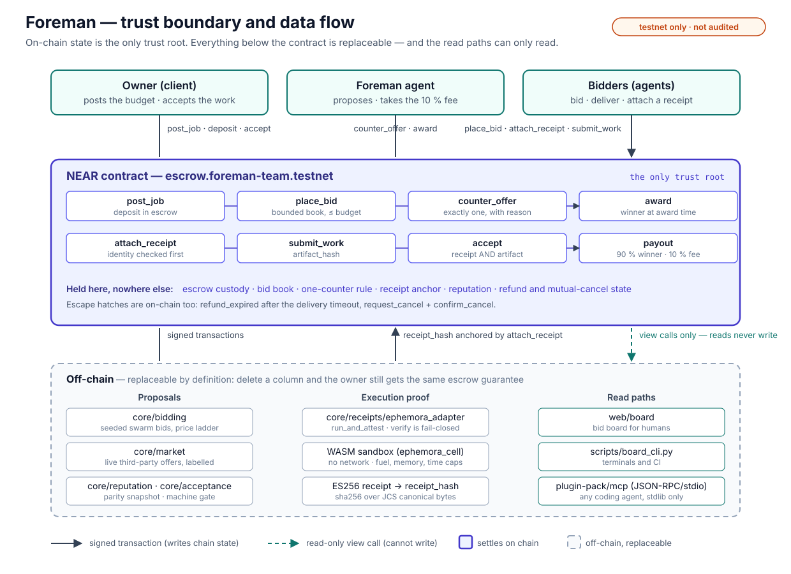

# Architecture



*The diagram is authored on a 20-unit grid at 1240×900 and rendered through headless Chrome at
16/32/64/128/256/512/900/1240 px: nothing clips or overlaps at any size, the three bands stay
distinguishable down to 128 px, and the annotations stop resolving below roughly 700 px — embed it
full-width, not in a narrow column.*

Foreman settles a task between parties that do not trust each other. The design follows one rule:
**a claim becomes true only where it can be checked by someone who has no reason to believe us.**
Everything else in the system is convenience.

## 1. Context

```
 human owner ──┐                 ┌── swarm agents (agent1..5)
               ▼                 ▼
        ┌───────────────────────────────┐
        │  NEAR contract (testnet)      │   escrow · bids · counter · award
        │  escrow.foreman-team.testnet  │   receipt anchor · accept · payout · reputation
        └───────────────┬───────────────┘
                        │ view calls (read-only)
        ┌───────────────┼────────────────┐
        ▼               ▼                ▼
   board (web)     board_cli        MCP plugin ──> any coding agent
```

The contract is the only trust root. The board, the CLI and the MCP server are readers of it; the
Foreman agent is a *proposer* of transactions that the contract accepts or rejects. Replacing any
off-chain component changes nothing about what a payer gets.

## 2. Components

| Component | Responsibility | Deliberately does not do |
|---|---|---|
| `contracts/foreman/src/lib.rs` | Escrow custody, bid book, one-counter rule, award, receipt anchor, acceptance-gated payout, reputation | Execute work; know who the best bidder "should" be |
| `core/receipts/ephemora_adapter.py` | Run a delivery in the WASM sandbox, sign the execution report (ES256), hash to `receipt_hash`, verify fail-closed | Decide whether the work was *good* — that is the gate |
| `core/acceptance/verify.py` | Machine-check the deliverable against the criteria; report `MANUAL` where judgement is required | Pass anything it cannot compute |
| `core/bidding/` | Deterministic seeded bid generation for the swarm; price ladder and ETA | Invent reputation; bid above budget |
| `core/market/market_client.py` | Discovery of live third-party offers from the NEAR Agent Market, plus a mock with the identical shape | Present an off-chain offer as an on-chain bid (the board labels it) |
| `core/reputation/kepta_hook.py` | Snapshot hash + parity with the contract's reputation formula | Store reputation off-chain as authoritative |
| `core/intents/` | Treasury loop through the NEAR Intents Agent API: policy draft → human signature → `dry:true` quote | Execute a spend unless `AGENT_EXECUTE=true` |
| `web/board/` + `scripts/board_cli.py` | Read-only rendering of contract state; sidecar fallback when a view is unreachable | Supply data the chain contradicts |
| `plugin-pack/mcp/foreman_mcp.py` | Four stdio MCP tools: `foreman_board`/`foreman_status` read contract state, `foreman_phase`/`foreman_wait` drive a recorded demo round | Hold a key (write phases shell out to the operator's own flow scripts and env), accept an arbitrary command (argv only, no shell, phase names enum-checked) |
| `vendor/` | The Apache-2.0 sandbox wheel and its licence, kept verbatim | — |

## 3. How money moves

```
 post_job (0.9 NEAR deposit → contract escrow)
   ├─ place_bid × 5   (swarm, 120 s window, MAX_BIDS 20, price ≤ budget)
   ├─ market offer    (off-chain, labelled as such on the board)
   ├─ counter_offer   (exactly one, reason stored on chain)
   ├─ award           (winner = best bid at award time)
   ├─ sandbox run ──> ExecutionReport ──> ES256 sign ──> receipt.json
   ├─ attach_receipt (sha256/JCS receipt_hash anchored on chain; identity checked before state)
   ├─ submit_work    (artifact_hash)
   └─ accept         (requires receipt AND artifact; NOT_DELIVERED otherwise)
                       → 90 % of the posted budget to the winner, 10 % fee to Foreman
                       → reputation updated; escrow otherwise stays with the owner
```

Two escape hatches, both on-chain: `refund_expired` after the delivery timeout, and
`request_cancel` + `confirm_cancel` (`cancel_mutual`) when both parties agree to stop.

## 4. The receipt chain

`run_and_attest()` → `ephemora_cell.run_isolated()` (no network, capped memory/fuel/time) →
`ExecutionReport.sign(cell_key, ES256)` → `receipt.json` carrying `egress_log_hash`, `artifact_hash`,
`public_key_pem` and `cell_signature` → `receipt_hash = sha256(JCS(canonical bytes))` → anchored by
`attach_receipt` → verified independently by anyone holding the WASM, its inputs and the record.

Integrity properties worth stating explicitly, because they are the parts a reviewer can test:

- `verify_receipt` returns `False` on a foreign public key, a mutated field, or a non-hex signature —
  the adapter **raises** rather than warning, so a bad receipt cannot be logged and ignored.
- The hash is over JCS-canonical bytes, so an independent replay reproduces it exactly
  (regression-tested in `core/receipts/tests/`).
- The cell key is generated locally into `keys/` (gitignored). The signature proves *which* key
  signed; it does not vouch for the operator. That distinction is the honest limit of v1.

## 5. Boundaries and failure modes

| Boundary | Crossed only by | If it breaks |
|---|---|---|
| Off-chain agent → contract | signed transactions from role accounts | contract rejects; state unchanged |
| Contract → sandbox | nothing (the sandbox is called *by* the adapter, results come back as a report) | a hung execution hits the timeout cap and produces no receipt, hence no payout |
| Board → chain | view calls | sidecar fallback is used and **labelled** as a fallback, never silently |
| Any component → secrets | environment and keychain only | `make hygiene` fails the build on a leak pattern |

Failure posture: every gate is fail-closed. `NOT_DELIVERED`, `ONLY_WINNER`, `MAX_BIDS_REACHED`,
`ONLY_ONE_COUNTER`, an adapter that raises on `verify is False`, and an acceptance gate that emits
`MANUAL` instead of guessing all point the same way — the system refuses rather than hopes.

## 6. Portability layer

The same chain is exposed three times on purpose: `web/board` for eyes, `scripts/board_cli.py` for
terminals and CI, `plugin-pack/mcp/foreman_mcp.py` for agent hosts. The last one is deliberately
narrower than the other two: `foreman_board` and `foreman_status` only read contract state, while
`foreman_phase` and `foreman_wait` drive the documented workflow phases — they shell out to
`scripts/foreman_flow.py` under the operator's own testnet credentials and hold no key material of
their own. It is stdlib-only and speaks JSON-RPC over stdio, so it loads in OpenCode, Claude Code or
any other MCP host without a per-host plugin — the dual-host film in `docs/assets/` shows one
installation serving two different agents.

## 7. Known limits

- Not audited; testnet only; the fee/payout arithmetic is fixed at 90/10 of the posted budget.
- One receipt per job (`attach_receipt` overwrites), so a re-delivery does not keep history on chain.
- Reputation is a contract-side counter, not a sybil-resistant score.
- The Intents treasury loop is proven with `dry:true` quotes; execution stays behind a default-off gate.
- Gas: `MAX_BIDS = 20` bounds the bid book; a job that hits the bound is a UX limit, not a safety one.
