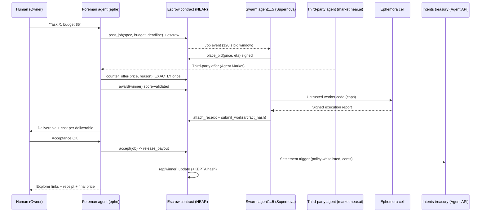

# Sequence — the one demo moment (benchmark for contract API and UI)

## Contract API (derived, v1-minimal)
`new(treasury) · post_job · place_bid · counter_offer · award · attach_receipt · submit_work · accept · release_payout · refund_expired · get_job · get_bids · get_rep`

## UI views (bid board)
1. Job card (spec, budget, countdown) · 2. Live bid wall (price/ETA/rep) · 3. Counter-offer card with reason · 4. Receipt panel (verifiable cell proof) · 5. Payout + reputation result card with explorer links.