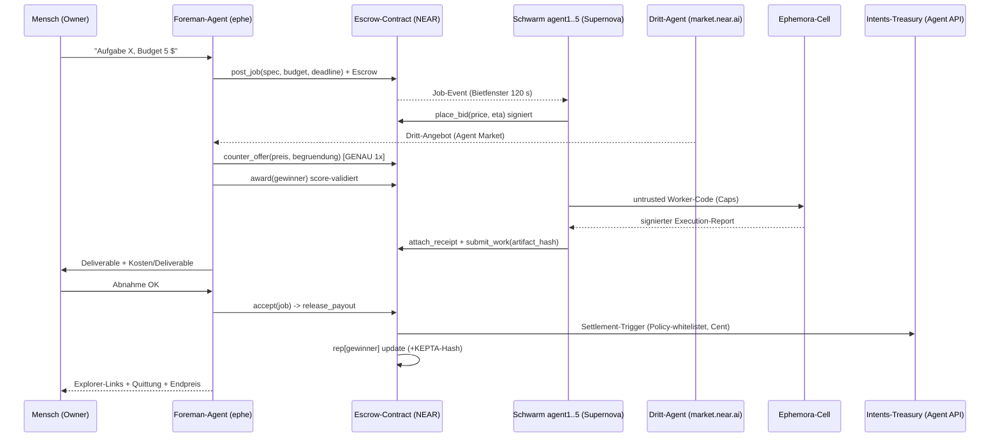

# Sequenz — der eine Demo-Moment (Maßstab für Contract-API und UI)

## Contract-API (abgeleitet, v1-minimal)
`new(treasury) · post_job · place_bid · counter_offer · award · attach_receipt · submit_work · accept · release_payout · refund_expired · get_job · get_bids · get_rep`

## UI-Sichten (Bietboard)
1. Job-Karte (Spec, Budget, Countdown) · 2. Live-Bid-Wand (Preis/ETA/Rep) · 3. Gegenofferte-Karte mit Begründung · 4. Receipt-Panel (Cell-Nachweis verifizierbar) · 5. Payout+Reputation-Ergebniskarte mit Explorer-Links.
